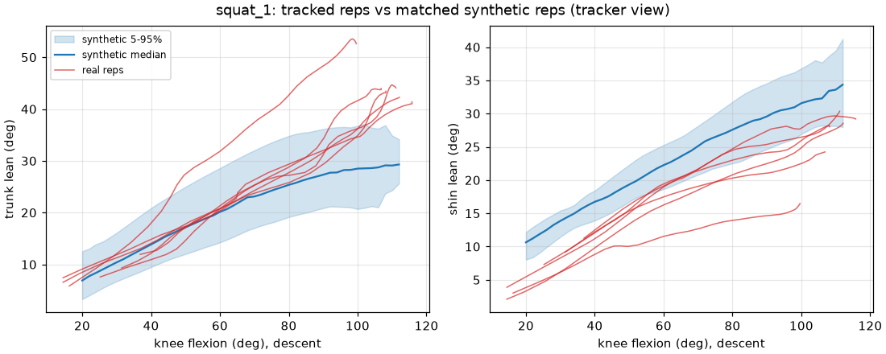

# Real-video check

Does a generated squat look like a real one once both are seen through a pose tracker? This compares two real videos, tracked with MediaPipe Pose, against synthetic reps of matched people, and measures the tracker's own noise.

Reproduce with:

```bash
PYTHONPATH=src python scripts/extract_video_landmarks.py VIDEO...          # only when adding videos
PYTHONPATH=src python scripts/real_video_check.py 60 --figures docs/figures  # about 20 s
```

## Data

| Clip | View | Person (apparent) | Arms | Reps | Notes |
|---|---|---|---|---|---|
| squat_1 | side-on (yaw scale 0.997); camera pans and zooms a little | woman, trainers | hands behind the head | 6 | trainer demo; the last rep is a "sit back" squat with vertical shins |
| squat_2 | about 48 deg from side-on (yaw scale 0.67) | man, barefoot | hands clasped at the chest | 13 | trainer demo; starts with a setup bend, which is correctly not counted as a rep |

Both are third-party videos. Only the MediaPipe landmark tracks are in the repository (`src/exercise_quality/data/real_video/`), with each video's SHA-256 in `manifest.json`. Sex is an assumption from appearance and is used only to pick which ANSUR II sample to match. MediaPipe Pose Landmarker heavy, VIDEO mode, MediaPipe 1.2.2.

## Method

1. **Tracker view.** Real tracks and synthetic reps are both reduced to the points MediaPipe gives on the near side (ear, shoulder, elbow, wrist, hip, knee, ankle, heel, toe), facing +x. They're then measured with the same code (`core/observed.py`, `exercises/squat/reps.py`), using a 6 Hz zero-lag low-pass filter. Trunk lean here is the hip-to-shoulder line, not the rib cage.
2. **Camera angle.** The yaw comes from MediaPipe's 3D landmarks: how far the hip axis is turned from the camera axis. Image x is divided by its cosine. Two alternatives were tested and rejected:
   - Fitting the thigh's swing ellipse in the image gave 0.93 on the side-on clip. The knees travel out over the toes, and that looks like yaw.
   - Taking angles straight from the 3D landmarks put the side-on clip's knee and shank 5-7 deg off the image values.
3. **Reps.** A rep is a dip in hip-above-ankle height of at least 15% with at least 45 deg of knee bend. Phases are measured at 5% and 95% of each rep's excursion.
4. **Matched synthetic reps.** The people are the 40 ANSUR II people closest in thigh and trunk proportions. Foot and neck ratios aren't used: MediaPipe's "foot index" isn't the toe tip, and the ear is placed by assumption. Each real rep gets 60 synthetic reps with:
   - the same peak knee bend, tempo (calibrated on the measured phases) and arm angles;
   - everything else sampled from the validated population spreads;
   - the tracker-noise model applied (below).
5. **Balance check.** The centre of mass over the foot is estimated from the tracked pose with the matched body (`core/observed_balance.py`). It assumes a flat foot and a straight trunk along the hip-shoulder line. The thigh and shank take the length they appear to have in that frame. When the knees travel out over the toes, the thigh looks shorter from the side, and rebuilding the pose with its full length would put the hip, and the centre of mass, about 0.1 foot lengths too far back. On exact synthetic reps the estimate is off by 0.006 ± 0.010 foot lengths; through the full noise model, 95% of errors are within 0.08.

## Results

### squat_1 (side-on): legs, tempo and balance match; the trunk leans more

| Measure (median over 6 reps) | Real | Synthetic | Real rep's percentile among matched synthetic |
|---|---|---|---|
| Thigh angle at the bottom (-90 = parallel) | -82.9 | -80.0 | 24 |
| Shin lean at the bottom | 28.3 | 29.3 | 30 |
| Hip drop (fraction of standing height) | 0.52 | 0.49 | 94 |
| **Trunk lean at the bottom** | **43.6** | **32.3** | **99 (6 of 6 reps above 95)** |
| Trunk lean at 60 / 90 deg knee | 20.8 / 31.8 | 25.1 / 31.0 | 18 / 60 |
| Hip travel back (fraction of leg) | 0.16 | 0.21 | 14 |
| Centre of mass over the foot at the bottom | 0.40 | 0.35 | 67 |
| Trunk lean up minus down at the same hip height | 4.1 | 1.3 | 96 (3 of 6 above 95) |
| Descent / ascent (s) | 0.80 / 0.70 | 0.91 / 0.68 | 27 / 56 |



- Depth, shin lean, tempo and the balance check all sit inside the synthetic spread. Her bottom position is balanced over mid-foot: 0.40-0.46 of foot length in reps 1-4, against 0.363 ± 0.08 in Ishida's force-plate data. So the tracked angles are physically consistent rather than tracker artefacts.
- **The trunk curve has a different shape.** The real lean rises roughly linearly with knee bend and keeps rising to the bottom. The model's rises earlier (higher at 60 deg) and flattens past 90 deg, so it ends 11 deg lower. The real person balances the extra lean by keeping her hips further forward (hip travel back 0.16 vs 0.21).
- The sixth rep (vertical shins, centre of mass near the heel) is far outside the synthetic spread on shin lean (percentile 0), as a deliberate "sit back" demonstration should be.

### squat_2 (oblique): unreliable angles, but the trunk still leans far more

- Even standing, the corrected pose puts the centre of mass at 0.76 of foot length. People stand at 0.31-0.58 (Fujiwara 2010). No yaw value from 0.67 to 1.0 brings both standing and bottom into a plausible range, so the oblique geometry is distorted and its angles shouldn't be trusted one by one. Out-of-plane movement seen at 48 deg (knees pushed out towards the camera) leaks into the corrected angles.
- One conclusion survives. Turning the camera can only shrink forward distances, so the uncorrected image gives a lower bound on trunk lean: **48.8 deg at the bottom against the model's 30**. This man is a hip-dominant squatter (hips far back) and leans much more than the matched synthetic people.
- Tempo matches (descent 1.2 s, ascent 0.4 s).

### Tracker noise model (`core/tracker_noise.py`)

Measured on the side-on clip and reproduced on synthetic reps:

| Quantity | Real | Model | |
|---|---|---|---|
| Jitter above 6 Hz, hip / knee / ankle (fraction of leg length) | 0.0032 / 0.0019 / 0.0017 | 0.0030 / 0.0018 / 0.0016 | fitted |
| Angle jitter, knee / thigh / shin / trunk (deg) | 0.52 / 0.41 / 0.20 / 0.25 | 0.45 / 0.33 / 0.22 / 0.31 | not fitted |
| Thigh length at 100 deg knee / standing | 0.90 | 0.91 | fitted |
| Shin, trunk length at 100 deg knee / standing | 0.98, 1.01 | 1.00, 0.99 | not fitted |

The model has three parts:

- **Jitter.** Nearly white noise, 0.2-1% of leg length. 40% of it is shared by all points, which is camera shake: that share is about 0.1 on the fixed-camera clip.
- **Drift.** Each landmark wanders by 1.8% of its segment's length, with a half-correlation time of 0.15 s.
- **Knees out of plane.** The thigh looks 9% shorter from 60 deg of knee bend because the knee travels sideways, invisible from the side. Modelled as a 24 deg sideways thigh angle.

Two consequences:

- Frame-to-frame jitter is small; the slow drift and the knees-out projection are what matter.
- The knees-out projection makes a side view read the knee about 3 deg less bent, the thigh about 3 deg deeper and the shin a few degrees more upright than the same squat done in a single plane. That's the same direction as published MediaPipe knee errors.

All of it comes from one person in one clip; the spreads are assumptions.

## What this tells us about the model

1. **Trunk lean late in the descent is probably too low.** Three independent hints now point the same way:
   - squat_1 (side-on, balanced) leans 11 deg more at the bottom;
   - squat_2 leans at least 19 deg more;
   - Zawadka's lumbar and hip ranges imply about 12 deg more rib-cage rotation at maximal depth than the model gives (gap 1 in [validation.md](validation.md)).

   The cause is the preferred-trunk curve. It's fitted to Ishida's 60 deg, 90 deg and peak values at a 2 s tempo, and it bends over early. Two trainer demos at 0.8-1.2 s descents aren't a population, and MediaPipe's hip point could drift at depth (not measurable here). So **nothing was refitted**. What's needed is more side-on videos, ideally of untrained people at a controlled tempo, or a study reporting trunk lean through the whole descent.
2. **Hip placement is a style, and styles vary more than the model allows.** squat_1 keeps the hips forward and leans; squat_2 sends them far back. The model's hip travel spread is narrow because hip position falls out of balance plus the preferred lean.
3. **Real people rise slightly hips-first; the model doesn't.** At the same hip height, both real people lean more on the way up than on the way down (4.1 and 3.0 deg against 1.3 and 1.1 in their matched synthetic reps, 96th and 93rd percentiles). The generator's ascent is the time-reverse of its descent, an assumption with no ascent data behind it (model.md). Tracker lag that differs between landmarks would add the same signature, so this needs a reference measurement before changing the model.
4. Depth geometry, shin lean, tempo and bottom balance match on the side-on clip.

## Limits of this check

- Two people, both trainers, both demonstrating. Not a sample of anyone.
- No reference system: MediaPipe landmark bias against true joint centres can't be measured, only its noise.
- One clip is oblique; the yaw correction and the noise model's spreads are calibrated on a single side-on clip.

Add side-on videos (full body in frame, camera at hip height, 2-5 m away) to `scripts/extract_video_landmarks.py`, and the check picks them up automatically.
